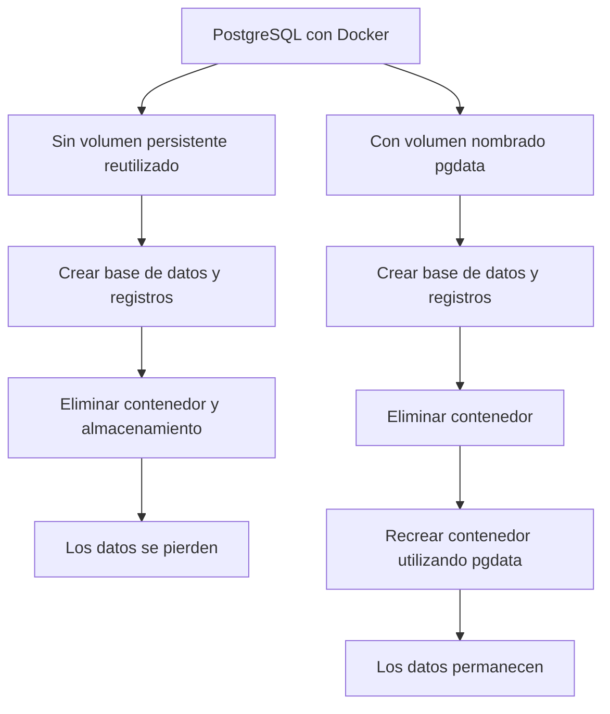
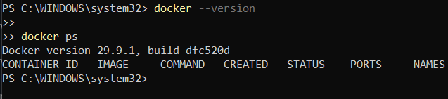
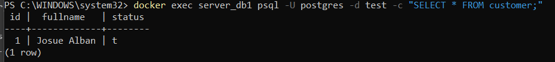
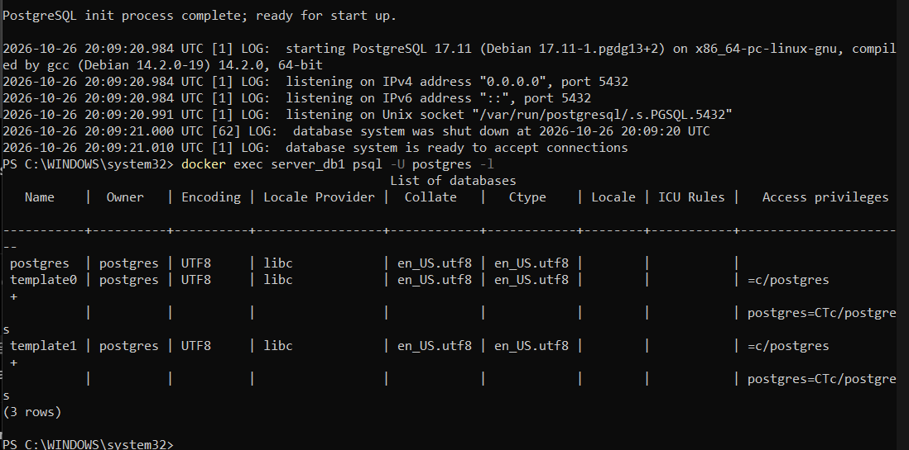
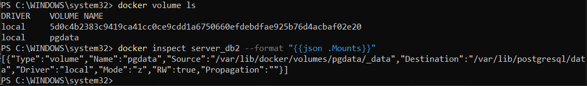
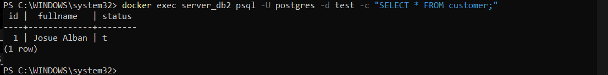
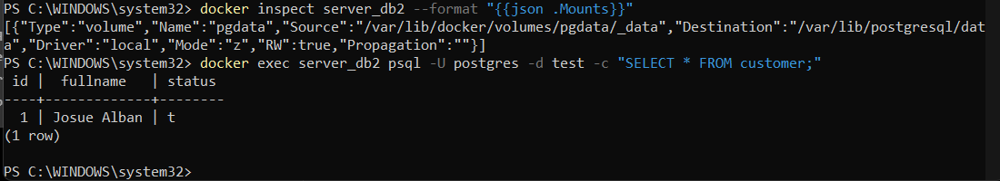
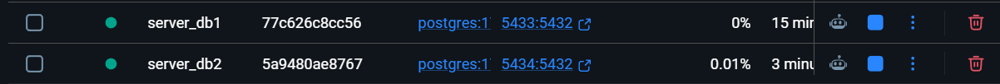

# Informe de práctica N.º 3: Persistencia de datos en PostgreSQL mediante volúmenes de Docker

> **Estudiante:** Josue Albán  

> **Asignatura:** Tendencias Tecnológicas  

> **Fecha:** 26 de octubre de 2026


## 1. Título

**Comprobación de la persistencia de una base de datos PostgreSQL con y sin un volumen nombrado en Docker.**

## 2. Tiempo de duración

**Duración registrada:** 40 minutos.

## 3. Fundamentos

### Contenedores y almacenamiento en Docker

Docker permite ejecutar aplicaciones dentro de contenedores, que son entornos aislados y reproducibles. Cada contenedor se crea a partir de una imagen que contiene los archivos y configuraciones necesarios para iniciar una aplicación. En esta práctica se utiliza la imagen oficial de PostgreSQL, que permite ejecutar un sistema gestor de bases de datos dentro de Docker sin instalar PostgreSQL directamente en Windows.

Una característica importante de los contenedores es su ciclo de vida. Un contenedor se puede iniciar, detener, eliminar y volver a crear. Cuando se elimina, su capa de escritura propia deja de estar disponible. Esto genera un problema para aplicaciones que almacenan información: una base de datos no debería perder los registros de sus usuarios por el simple hecho de reemplazar su contenedor.

Docker ofrece volúmenes para separar el almacenamiento de los datos del ciclo de vida de los contenedores. Un **volumen nombrado** tiene un identificador, por ejemplo, `pgdata`, y Docker puede volver a conectarlo a un contenedor nuevo. Así, aunque el contenedor sea eliminado, los archivos del volumen permanecen disponibles mientras no se elimine expresamente el propio volumen. Esta técnica resulta útil al actualizar aplicaciones, recrear entornos y mantener información que requiere persistencia.

En PostgreSQL, los datos se almacenan en un directorio dentro del contenedor. Para la versión `postgres:17` la ruta indicada para montar el volumen es `/var/lib/postgresql/data`. Es importante utilizar una versión fija porque a partir de PostgreSQL 18 cambió el directorio recomendado para montar los datos. Además, la imagen de PostgreSQL 17 declara un volumen anónimo de manera automática en su directorio de datos; en la primera parte de esta práctica se elimina ese volumen anónimo al borrar el contenedor y se crea otro contenedor sin reutilizar almacenamiento anterior.

La actividad compara dos escenarios. En el primero se crea la base de datos `test` y una tabla `customer`, pero al destruir el contenedor y recrearlo sin reutilizar su almacenamiento, se espera que la información desaparezca. En el segundo escenario se monta un volumen nombrado `pgdata`, se repiten los registros y luego se recrea el contenedor usando el mismo volumen. Se espera recuperar tanto la base de datos como los registros previamente insertados.

Esta comparación permite comprender que **detener un contenedor no equivale a eliminarlo**, que un volumen no es lo mismo que una imagen y que persistencia de datos no significa tener una copia de seguridad. Los respaldos siguen siendo necesarios para protegerse contra errores, corrupción o eliminación accidental del propio volumen.

### Figura 1. Esquema de persistencia de datos en PostgreSQL



**Figura 1.** Comparación del comportamiento de PostgreSQL con y sin persistencia de datos.


## 4. Conocimientos previos

- Conceptos básicos de imágenes, contenedores y puertos de Docker.

- Uso de PowerShell o de una terminal para ejecutar comandos.

- Nociones de SQL: `CREATE DATABASE`, `CREATE TABLE`, `INSERT` y `SELECT`.

- Conceptos de conexión a PostgreSQL: host, puerto, usuario y contraseña.

- Uso básico de Git y GitHub para entregar el informe Markdown.

## 5. Objetivos a alcanzar

- Crear y gestionar contenedores PostgreSQL con Docker.

- Crear una base de datos y registrar información en una tabla.

- Verificar el comportamiento de los datos después de eliminar un contenedor sin reutilizar su almacenamiento.

- Crear un volumen nombrado y asociarlo a PostgreSQL.

- Comprobar la persistencia de información al eliminar y recrear un contenedor con el mismo volumen.

- Documentar las evidencias y publicar el informe en GitHub.

## 6. Equipo necesario

- Computador con Windows y Docker Desktop activo.

- Imagen Docker `postgres:17`.

- Terminal PowerShell.

- DataGrip, TablePlus o cliente PostgreSQL equivalente (opcional; también se usa `psql` dentro del contenedor).

- Editor de texto o Visual Studio Code para Markdown.

- Git y cuenta de GitHub.

## 7. Material de apoyo

- [Plantilla del informe del docente](https://github.com/maguaman2/informe-tendencias/blob/main/informe.md).

- [Docker: volúmenes](https://docs.docker.com/engine/storage/volumes/).

- [Docker: guía de PostgreSQL](https://docs.docker.com/guides/postgresql/).

- [Imagen oficial PostgreSQL en Docker Hub](https://hub.docker.com/\_/postgres).

## 8. Procedimiento

### Parte 1. Base de datos sin volumen nombrado reutilizable

**Paso 1. Comprobar Docker.** En PowerShell ejecutar:

```powershell

docker --version

docker ps

```

**Figura 2.** Docker Desktop o terminal comprobando que Docker está disponible.




**Paso 2. Crear el contenedor **`server_db1`**.**

```powershell

docker run -d --name server_db1 -e POSTGRES_PASSWORD=postgres123 -p 5433:5432 postgres:17

```

**Paso 3. Crear la base **`test`** y la tabla **`customer`**.**

```powershell

docker exec server_db1 psql -U postgres -c "CREATE DATABASE test;"

docker exec server_db1 psql -U postgres -d test -c "CREATE TABLE customer (id SERIAL PRIMARY KEY, fullname VARCHAR(100), status BOOLEAN);"

```

**Paso 4. Insertar un cliente y consultar los datos.**

```powershell

docker exec server_db1 psql -U postgres -d test -c "INSERT INTO customer (fullname, status) VALUES ('Cliente de prueba', TRUE);"

docker exec server_db1 psql -U postgres -d test -c "SELECT * FROM customer;"

```

**Figura 3.** Registro insertado en la tabla `customer` del primer contenedor.


**Paso 5. Detener y eliminar el contenedor.** El parámetro `-v` elimina el volumen anónimo asociado al contenedor, pero no debe usarse para borrar un volumen nombrado destinado a conservar datos.

```powershell

docker stop server_db1

docker rm -v server_db1

```

**Paso 6. Recrear el contenedor y comprobar la ausencia de la base **`test`**.**

```powershell

docker run -d --name server_db1 -e POSTGRES_PASSWORD=postgres123 -p 5433:5432 postgres:17

docker exec server_db1 psql -U postgres -l

```

**Figura 4.** Lista de bases después de recrear `server_db1` sin recuperar el almacenamiento anterior.




### Parte 2. Base de datos con volumen nombrado

**Paso 7. Crear el volumen **`pgdata`**.** Si `pgdata` ya existe, comprobar primero que no contiene datos previos que puedan afectar la prueba.

```powershell

docker volume create pgdata

docker volume ls

```

**Figura 5.** Volumen `pgdata` disponible en Docker.


**Paso 8. Crear **`server_db2`** utilizando **`pgdata`**.**

```powershell

docker run -d --name server_db2 -e POSTGRES_PASSWORD=postgres123 -p 5434:5432 -v pgdata:/var/lib/postgresql/data postgres:17

```

**Paso 9. Crear la base, la tabla e insertar datos.**

```powershell

docker exec server_db2 psql -U postgres -c "CREATE DATABASE test;"

docker exec server_db2 psql -U postgres -d test -c "CREATE TABLE customer (id SERIAL PRIMARY KEY, fullname VARCHAR(100), status BOOLEAN);"

docker exec server_db2 psql -U postgres -d test -c "INSERT INTO customer (fullname, status) VALUES ('Cliente persistente', TRUE);"

docker exec server_db2 psql -U postgres -d test -c "SELECT * FROM customer;"

```

**Figura 6.** Registro guardado dentro del contenedor que utiliza `pgdata`.



**Paso 10. Detener, eliminar y recrear el contenedor con el mismo volumen.**

```powershell

docker stop server_db2

docker rm server_db2

docker run -d --name server_db2 -e POSTGRES_PASSWORD=postgres123 -p 5434:5432 -v pgdata:/var/lib/postgresql/data postgres:17

```

**Paso 11. Verificar que la tabla y su información continúan disponibles.**

```powershell

docker exec server_db2 psql -U postgres -d test -c "SELECT * FROM customer;"

```

**Figura 7.** Registro recuperado después de recrear `server_db2` utilizando el mismo volumen.




**Conexión opcional con DataGrip / TablePlus:** host `localhost`; usuario `postgres`; contraseña de laboratorio `postgres123`; puertos `5433` (primera parte) y `5434` (segunda parte); base `test` cuando exista.

> **Nota:** Los nombres y comandos anteriores son pasos de ejecución. Las capturas deben ser reales y tomadas en tu equipo; no se deben presentar como resultados obtenidos antes de realizar las pruebas.

## 9. Resultados esperados y análisis

\| Escenario | Comprobación después de recrear el contenedor | Resultado esperado | Resultado observado |

\|---|---|---|---|

\| `server_db1` sin reutilizar volumen | Consultar lista de bases | La base `test` no aparece | [Escribir lo observado según la figura 4] |

\| `server_db2` con `pgdata` | Consultar tabla `customer` de `test` | Los registros creados siguen presentes | [Escribir lo observado según la figura 7] |

**Análisis de resultados:** La diferencia entre ambos procedimientos está en el almacenamiento reutilizado. En la primera prueba, tras eliminar `server_db1` junto con su volumen anónimo y crear un contenedor nuevo, PostgreSQL inicializa un directorio de datos nuevo. En la segunda, `server_db2` vuelve a montar `pgdata`, por lo que se espera que PostgreSQL conserve la base `test` y los registros de `customer`. Las capturas de las figuras 4 y 7 deben respaldar los resultados efectivamente obtenidos. **Antes de entregar, completa la columna «Resultado observado» según tu ejecución.**

### Conclusiones

La práctica permite comprender que un contenedor y los datos almacenados por un servicio son elementos diferentes. Eliminar un contenedor no implica necesariamente borrar los datos cuando estos están en un volumen persistente que se conserva y vuelve a asociarse. En cambio, al recrear PostgreSQL sin recuperar el almacenamiento anterior, se inicia una instancia sin la base de datos creada previamente.

Por esta razón, los volúmenes nombrados resultan importantes para aplicaciones que necesitan mantener información, como sistemas de clientes, inventarios y servicios web conectados a bases de datos. También es importante recordar que los volúmenes no reemplazan las copias de seguridad.

> **Comprobación final pendiente de incorporar al informe:** verifica que las capturas correspondientes muestren el resultado real de cada caso y completa la columna de observaciones.

## 10. Bibliografía

- Docker, Inc. (s. f.). **Volumes**. Docker Docs. https://docs.docker.com/engine/storage/volumes/

- Docker, Inc. (s. f.). **PostgreSQL specific guide**. Docker Docs. https://docs.docker.com/guides/postgresql/

- Docker Official Images. (s. f.). **postgres**. Docker Hub. https://hub.docker.com/\_/postgres

- maguaman2. (s. f.). **Informe tendencias: plantilla de informe** [Repositorio de GitHub]. https://github.com/maguaman2/informe-tendencias

\---

> **Antes de publicar:** reemplaza los marcadores de duración y resultados observados; agrega las seis capturas reales con los nombres indicados en `evidencias/`. No incluyas contraseñas reales o datos sensibles en imágenes ni en el repositorio.
